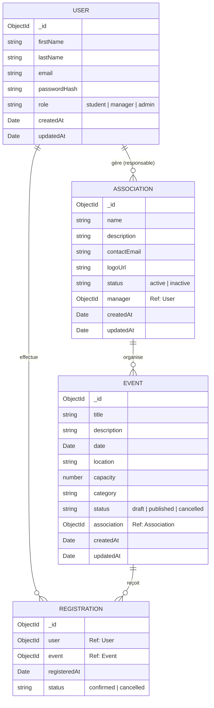

# Cahier des Charges — MDL-Beaussier

> **Cours** : Développement Web (TypeScript / Node.js / Express / MongoDB / Mongoose / EJS / Bootstrap)
> **Projet fil-rouge** : Vie associative et événements de l'établissement

---

## 1. Contexte et Objectifs

L'application web **MDL-Beaussier** est dédiée à la vie associative et aux événements de l'école. Elle vise à centraliser la découverte des associations étudiantes, la publication d'événements et la gestion des inscriptions, tout en offrant un espace d'administration sécurisé (back-office) pour les responsables associatifs et les administrateurs.

### Objectifs principaux
1. Permettre aux **étudiants** de créer un compte, de s'authentifier et de gérer leur session.
2. Permettre la **consultation** des associations et des événements de l'établissement (avec recherche et filtrage).
3. Permettre aux étudiants de **s'inscrire** aux événements proposés, de consulter leurs inscriptions et d'annuler une inscription.
4. Offrir un **back-office** sécurisé permettant aux responsables autorisés et aux administrateurs de gérer les associations, les événements et le suivi des inscrits.

---

## 2. Rôles et Gestion des Droits

| Rôle | Périmètre d'accès | Droits et permissions |
| :--- | :--- | :--- |
| **Visiteur (Non connecté)** | Front public | Consultation des associations actives et des événements publiés, accès aux pages de connexion et d'inscription. |
| **Étudiant (`student`)** | Front public + Espace personnel | Inscription à un événement, annulation de sa propre inscription, consultation de l'historique de ses inscriptions. |
| **Responsable associatif (`manager`)** | Front public + Back-office restreint | Gestion (création, modification, suppression, publication) uniquement des données et événements liés à **son association**, consultation de la liste des inscrits aux événements de son association. |
| **Administrateur (`admin`)** | Front public + Back-office complet | Gestion complète de toutes les associations (création, modification, activation/désactivation), de tous les événements, des utilisateurs et des inscriptions. |

---

## 3. Modèle de Données (Schémas Mongoose & Relations)

L'application repose sur **quatre entités principales** stockées dans MongoDB et modélisées via Mongoose :

### Règles métier et validations
- **Unicité de l'email** utilisateur et hashage sécurisé du mot de passe (`bcryptjs`).
- **Prévention des doubles inscriptions** : un utilisateur ne peut avoir qu'une seule inscription active par événement (index composé unique `{ user: 1, event: 1 }` ou vérification métier).
- **Respect de la capacité maximale** : refus d'une nouvelle inscription lorsque le nombre d'inscriptions confirmées atteint la `capacity` de l'événement.
- **Contrôle des droits de modification** : vérification systématique via middleware que l'utilisateur connecté est soit `admin`, soit le `manager` rattaché à l'association concernée.

---

## 4. Spécifications Fonctionnelles

### 4.1. Front-end (Interface Utilisateur Publique & Étudiante)
- **Authentification & Session** :
  - Formulaire d'inscription étudiant.
  - Formulaire de connexion et bouton de déconnexion.
  - Persistance de la session utilisateur.
- **Catalogue des Associations** :
  - Liste des associations actives avec logo, description et contact.
  - Page détail d'une association listant ses événements à venir.
- **Catalogue des Événements** :
  - Liste des événements publiés.
  - Recherche par mot-clé et filtrage par catégorie, association ou date.
  - Fiche détaillée d'un événement (titre, description, date, lieu, places restantes, association organisatrice).
- **Gestion des Inscriptions (Espace Étudiant)** :
  - Bouton d'inscription rapide sur la fiche événement.
  - Page « Mes inscriptions » listant les événements rejoints avec possibilité d'annuler.

### 4.2. Back-office (Administration & Gestion Associative)
- **Tableau de bord** : vue synthétique adaptée au rôle (`admin` ou `manager`).
- **Gestion des Associations** :
  - Création et modification des informations d'une association.
  - Activation / désactivation d'une association (`admin`).
- **Gestion des Événements** :
  - Création, modification et suppression d'événements.
  - Publication / dépublication d'un événement.
- **Suivi des Inscrits** :
  - Consultation de la liste des étudiants inscrits pour chaque événement (avec compteur de capacité remplie).

### 4.3. Back-end (API & Logique Serveur)
- Opérations **CRUD complètes** pour les 4 ressources (`User`, `Association`, `Event`, `Registration`).
- Middlewares d'authentification et de contrôle d'autorisation par rôle (`isAuthenticated`, `hasRole`, `isAssociationManagerOrAdmin`).

---

## 5. Architecture Technique (MVC)

- **Langage** : TypeScript (compilé vers Node.js / exécuté avec `tsx` en développement).
- **Serveur Web** : Express.js.
- **Moteur de vues** : EJS (`ejs` + `express-ejs-layouts`) avec séparation claire entre les vues du **Front public** (`src/views/front/`) et du **Back-office** (`src/views/backoffice/`).
- **Interface & Styles** : HTML5, CSS3, Bootstrap 5, JavaScript client.
- **Base de données** : MongoDB avec l'ODM Mongoose.
